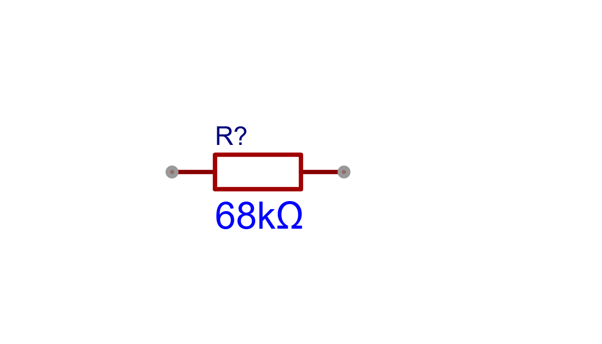
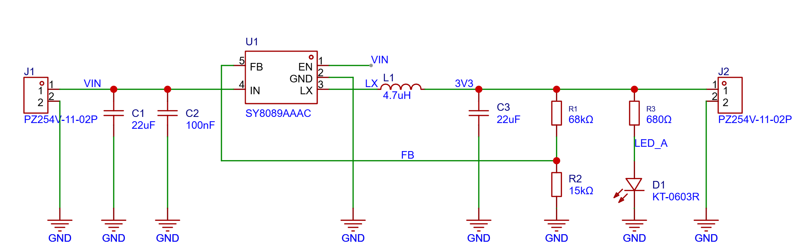
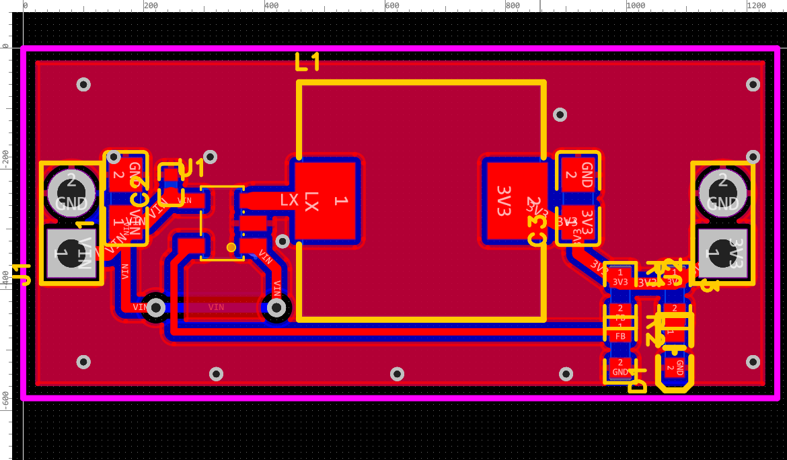
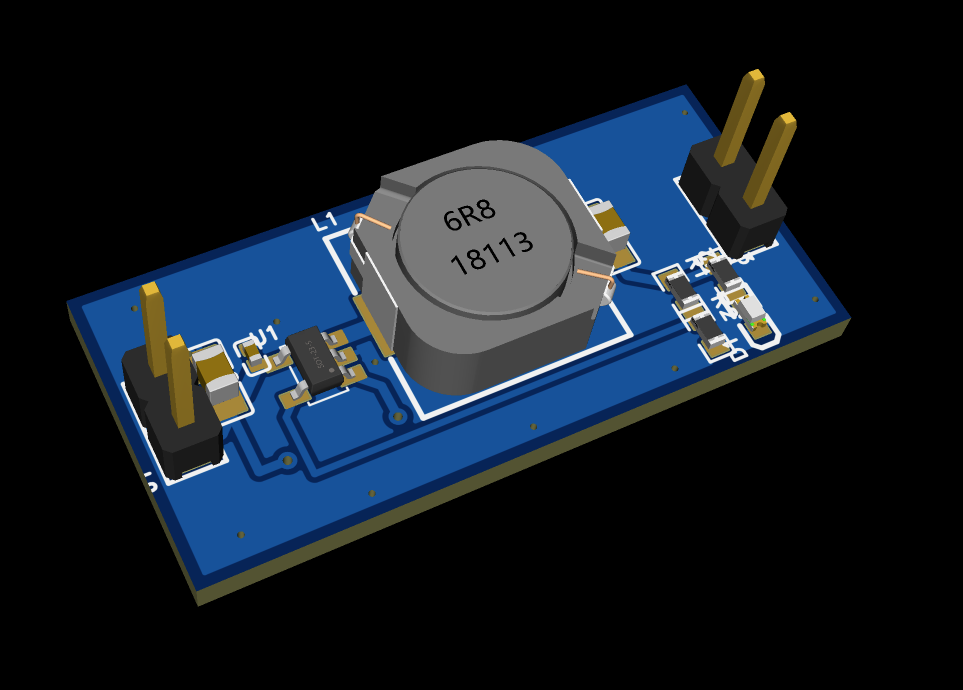

# EasyEDA přes Claude Code

Instrukce, které si načteš do Claude Code a necháš je provést. Zprovozní spojení mezi
Claude a desktopovým klientem **EasyEDA Pro** a pak ověří, že to opravdu funguje — od
umístění jediného rezistoru až po celý návrh desky s čistým DRC.

Patří k článku [**EasyEDA přes Claude Code**](https://ok2mtw.blogspot.com/2026/11/easyeda-pres-claude-code.html)
na blogu OK2MTW.

> [!WARNING]
> **Hobby projekt, ne produkt.** Nikdo za něj neručí a nikdo nenese odpovědnost za škody,
> za vyrobené desky ani za spotřebované tokeny.
>
> Návrh desky je pro model drahá úloha. Jeden malý měnič spotřebuje znatelnou část denního
> limitu a **větší projekt ti denní nebo týdenní limit může vyčerpat celý**. Pouštěj to ve
> chvíli, kdy ten limit zrovna nepotřebuješ na práci.

> [!CAUTION]
> **Přečti si ty soubory, než je pustíš.** Nejsou to instrukce pro tebe, je to text, který
> **vykoná Claude** — udělá, co v nich stojí, včetně instalací, příkazů a otevírání odkazů.
> Jsou krátké a v čisté češtině, zabere to pár minut.
>
> Platí to i o těchhle. Repozitář spravuju já, ale kdyby se k němu někdo dostal, podstrčený
> odkaz nebo příkaz poznáš jedině tak, že se podíváš. Ber to jako návyk, ne jako nedůvěru:
> instrukce pro agenta stažené odkudkoliv si přečti dřív, než je spustíš.
>
> Jestli ti něco nesedí, porovnej si to s
> [historií commitů](https://github.com/OK2MTW/easyeda-claude-code/commits/main).

## Co je tu

| Soubor | K čemu |
|---|---|
| [`easyeda-claude-setup.md`](easyeda-claude-setup.md) | Instalace a zprovoznění. Zkontroluje si prostředí, doinstaluje, co chybí, a sám si ověří, jestli se od napsání návodu něco nezměnilo. |
| [`easyeda-test-1-spojeni.md`](easyeda-test-1-spojeni.md) | Nejkratší test. Umístí na plátno rezistor a uklidí po sobě. Spotřeba zanedbatelná. |
| [`easyeda-test-2-navrh.md`](easyeda-test-2-navrh.md) | Celý návrh step-down měniče 5 V → 3,3 V na hotovém zadání. Schéma, ERC, PCB, routing, DRC. **Tohle už něco stojí.** |

## Jak to použít

**1.** Potřebuješ licenci Claude Code a [desktopový klient EasyEDA Pro](https://easyeda.com/page/download)
(ne webovou Standard verzi). Zbytek doinstaluje Claude sám.

**2.** Stáhni si tenhle repozitář — buď
[jako ZIP](https://github.com/OK2MTW/easyeda-claude-code/archive/refs/heads/main.zip), nebo:

```
git clone https://github.com/OK2MTW/easyeda-claude-code.git
```

**3.** Otevři v té složce terminál, spusť `claude` a napiš:

```
Přečti easyeda-claude-setup.md a proveď to.
Po každé fázi mi napiš výsledek a počkej, až ti řeknu dál.
```

Dvě věci uděláš ručně: naimportuješ rozšíření v EasyEDA a založíš prázdný projekt. Claude
ti napíše přesně kam kliknout.

**4.** Pak stejným způsobem pusť `easyeda-test-1-spojeni.md` a teprve potom
`easyeda-test-2-navrh.md`.

> [!IMPORTANT]
> **Nejdřív most, teprve pak Reconnect.** Když dáš v EasyEDA Reconnect dřív, než běží most,
> rozšíření to po pár pokusech vzdá a samo se znovu nerozjede. Většina „nespojí se to" je tohle.

## Jak to dopadlo u mě



*Test 1. Rezistor, který na plátno umístil Claude. Označení `R?` je správně — čísluje se až
při převodu do PCB.*



*Test 2, fáze A — schéma, ERC bez chyb. Hlavní cesta v jedné řadě, zemní symboly v jedné
řadě pod ní, zpětná vazba vedená vodičem.*



*Test 2, fáze C — deska odroutovaná, DRC bez chyb. Zem je rozlitá na obou vrstvách a sešitá
prokovy. Dvojice prokovů vlevo dole je přeskok napájení pro enable.*



*Táž deska ve 3D náhledu. Pozor na tlumivku: na modelu má napsáno `6R8`, osazená je přitom
TDK CLF10040T-4R7N-D, tedy 4,7 µH. 3D ukazuje modely z knihovny, ne hodnoty tvých součástek.*

## Co ti to nepohlídá

Claude je silný ve výpočtech a v tom, že nezapomene spustit kontrolu. Slabý je v layoutu
a v EMC. Sám musíš posoudit:

- plochy proudových smyček a vzdálenost kondenzátorů od pouzdra
- odvod tepla a hustotu prokovů
- pinout a footprint proti datasheetu
- mechanické kolize a 3D náhled

**Deska z Testu 2 není připravená k výrobě** a není to její účel. Výrobní data se generují
až po kontrole člověkem, a to platí i když DRC vrací prázdné pole.

## Bezpečnost

Most mezi Claude a editorem spouští v EasyEDA **libovolný JavaScript a nemá žádnou
autentizaci**. Musí zůstat na localhostu. Neotvírej ten port ve firewallu a nespouštěj to
na stroji, ke kterému má přístup někdo další.

## Zpětná vazba

Narazíš-li na něco, co v instrukcích nesedí, založ issue. Instrukce si mají odchylky
zapisovat samy do `ODCHYLKY.md` — jeho obsah je přesně to, co se hodí nahlásit.
